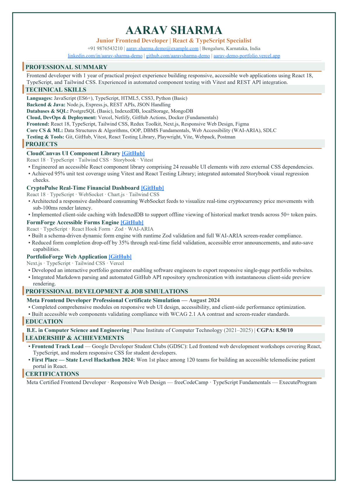
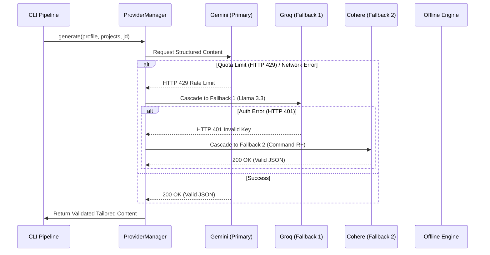

# AI Resume Builder
### Multi-Profile | AI-Powered | ATS-Aware | Python CLI

A modular, production-ready Python CLI application that analyzes job descriptions, dynamically maps verified candidate evidence, selects the most relevant projects, and generates tailored, publication-grade **PDF and DOCX resumes guaranteed to fit on exactly one A4 page**.

The system features a **Multi-Provider AI Architecture** with automated fallback across 5 external LLM providers (Google Gemini, Groq, Cohere, OpenRouter, and Cloudflare Workers AI) down to a deterministic **Offline Python Engine**, enforces **Multi-Profile Data Isolation**, and scores the final document with a transparent **Local 100-Point ATS Readiness Scorer**.

---

## 1. Visual Preview

Below is an actual rendered resume generated by the system for the included synthetic demonstration candidate (**Aarav Sharma**, Frontend Developer) using the **Editorial Deep Teal &amp; Warm Copper** design palette.

<p align="center">
  
</p>

*Visual Specifications:* Single-column A4 format (595.27 × 841.89 pt), 1.5 pt Deep Teal (`#174A45`) rectangular border, Pale Mint (`#E9F0ED`) shaded section banners with a 2.5 pt Warm Copper (`#C47A42`) left accent bar, 1.3 pt copper divider rules, Times New Roman typography, and verified `#267BF1` clickable external hyperlinks.

---

## 2. Key Features

- **Multi-Profile Data Isolation:** Supports multiple candidates via `profiles/{profile_id}/`. Each profile maintains independent master profiles, project databases, and candidate-specific rules with filesystem directory isolation, SHA-256 migration integrity verification, and path traversal defense.
- **Multi-Provider AI Fallback Cascade:** Prioritized execution across Google Gemini (Primary), Groq (Llama 3.3 70B), Cohere (Command-R+), OpenRouter, Cloudflare Workers AI, and a zero-network Offline Python Engine.
- **Guaranteed One-Page Fit:** Deterministic pagination and vertical spacing budget engine calculates total point height and dynamically adjusts typography (9.6 pt down to 9.0 pt) and line padding to prevent document overflow.
- **Intelligent Project Selection:** Algorithmic ranking based on Required Skills Coverage (45%), Responsibilities Alignment (25%), Tech Stack Similarity (20%), and Domain Relevance (10%), while respecting candidate-specific locked project rules.
- **Strict Factual Accuracy &amp; Anti-Hallucination:** AI providers receive candidate evidence with strict boundary prompts. Skills and metrics are strictly constrained to verified database records; unsupported job requirements are truthfully left unmade.
- **Privacy Sanitizer:** Automatically redacts candidate phone numbers, personal email addresses, and physical locations before sending evidence to external AI APIs.
- **Dual PDF &amp; DOCX Renderers:** Programmatically builds pixel-perfect ReportLab PDFs and matching WordprocessingML DOCX documents with identical typography, borders, shading, and clickable links.
- **Local ATS Readiness Scorer:** Extracts selectable text from the *actual rendered PDF* to evaluate Format Compatibility (30 pts), JD Relevance (50 pts), and Content Quality (20 pts).
- **Comprehensive Audit Package:** Every run generates versioned outputs containing PDF, DOCX, 150 DPI preview image, ATS reports (JSON &amp; TXT), content manifest, and change summaries.

---

## 3. Why This Project Was Built

Job applications today face two major bottlenecks:
1. **Commercial ATS Filtering:** Automated systems discard resumes due to complex multi-column layouts, missing keywords, unreadable tables, or page overflow.
2. **Generic vs. Fabricated Resumes:** Candidates often submit generic resumes that score poorly on relevance, or rely on uncontrolled LLMs that fabricate technical claims, metrics, and fake experiences.

**AI Resume Builder** solves both problems through **deterministic document engineering coupled with controlled LLM tailoring**:
- **Candidate data is immutable:** Only verified projects, skills, and achievements from the candidate's database are eligible for selection.
- **Layout is deterministic:** Formatting, pagination, borders, and typography are hard-coded in ReportLab and python-docx, not left to LLM guesswork.
- **AI is constrained:** LLMs are utilized solely to rephrase bullet points to emphasize relevant candidate evidence against the target JD.

---

## 4. Supported AI Providers

The system implements an abstracted provider interface (`BaseProvider`) supporting 5 external AI providers and 1 local engine:

| Priority | Provider | SDK / Protocol | Default Model | Free Tier Available |
| :---: | :--- | :--- | :--- | :---: |
| **1** | **Google Gemini** *(Primary)* | `google-genai` (SDK 2.0+) | `gemini-2.5-flash` | Yes (AI Studio) |
| **2** | **Groq API** | `groq` SDK | `llama-3.3-70b-versatile` | Yes (Console) |
| **3** | **Cohere API** | `cohere` SDK v2 | `command-r-plus-08-2024` | Yes (Trial key) |
| **4** | **OpenRouter API** | `httpx` REST client | `meta-llama/llama-3.3-70b-instruct:free` | Yes (Free models) |
| **5** | **Cloudflare Workers AI** | `httpx` REST client | `@cf/meta/llama-3.3-70b-instruct-fp8-fast` | Yes (Daily limit) |
| **6** | **Offline Python Engine** | Local Rule-Based | `offline/deterministic-engine` | 100% Offline |

*Fallback Behavior:* If a provider encounters HTTP 429 (Rate Limit), 401/403 (Auth Failure), 500/503 (Server Disruption), or timeout, the manager logs the incident and cascades to the next provider in the chain.

---

## 5. Technology Stack

```
AI Resume Builder
├── Core Language:       Python 3.10+ (Tested on Python 3.13)
├── Document Generation: ReportLab 4.x, python-docx 1.1+
├── PDF Extraction:      pypdf 4.x, pdfplumber 0.11+
├── Data Validation:     Pydantic 2.7+ (Strict JSON Schema)
├── AI SDKs:             google-genai 2.0+, groq 0.11+, cohere 5.0+, httpx 0.27+
├── CLI & UI:            Rich 13.x, Argparse, PowerShell 5.1/7+
└── Automated Testing:   Pytest 8.x (56 unit, integration, and security tests)
```

---

## 6. Application Architecture

```
User (CLI / PowerShell: resume.ps1)
  │
  ├──► [1/7] ProfileManager ──────► Load Candidate Profile & Config (profiles/{id}/)
  │
  ├──► [2/7] JDAnalyzer ──────────► Parse Job Description & Extract Required Skills
  │
  ├──► [3/7] RequirementMatrix ───► Map Evidence: Strong, Partial, Missing, Unsupported
  │
  ├──► [4/7] ProjectSelector ─────► Weighted Score Ranking + Candidate Fixed Rules
  │
  ├──► [5/7] ProviderManager ─────► Multi-Provider AI Cascade (Gemini → Groq → ... → Offline)
  │                                   └─► Pydantic Validation & Anti-Hallucination
  │
  ├──► [6/7] Document Renderers ──► ReportLab PDF (1-Page Fit) & python-docx DOCX
  │
  └──► [7/7] ATS Validator ───────► Extract Generated PDF Text & Calculate 100-pt Score
                                      └─► output/{profile_id}/{year}/{app}/
```

---

## 7. Complete Resume Generation Workflow

1. **Invocation:** User provides a job description via interactive paste or file path (`-JDPath`).
2. **Profile Loading:** `ProfileManager` validates the profile directory, loads `master_profile.json`, `projects.json`, and `profile_config.yaml`.
3. **JD Analysis:** `JDAnalyzer` normalizes text, strips noise, identifies technical requirements, and standardizes terms via canonical synonym mappings.
4. **Evidence Classification:** Categorizes requirements into Strong Match, Partial Match, Missing, and Unsupported (skills the candidate does not have).
5. **Project Ranking:** Calculates multi-factor relevance scores and selects the top 4 projects while enforcing profile-specific locks (e.g., fixed project slot rules).
6. **Privacy Redaction:** `sanitize_candidate_evidence_for_privacy()` strips raw contact details before passing evidence to external AI models.
7. **AI Content Generation:** Primary AI provider tailors summary and bullet points to emphasize relevant technologies while preserving factual accuracy.
8. **Schema Validation:** Response is parsed into `TailoredResumeContent` via strict Pydantic models. Malformed JSON is repaired or rejected.
9. **Document Rendering:**
   - `pdf_renderer.py` assembles ReportLab flowables with the Editorial Teal &amp; Copper palette.
   - `compression_engine.py` validates vertical point height against printable boundaries.
   - `docx_renderer.py` generates matching WordprocessingML document.
10. **ATS Verification:** `pypdf` extracts text from the final PDF to verify selectability, section headings, contact information, and keyword density.
11. **Package Writing:** Application package is written atomically to `output/{profile_id}/{year}/{Company}_{Role}_{Date}/`.

---

## 8. Multi-Profile Architecture

Candidate records are completely decoupled from shared application code:

```
profiles/
├── registry.json                    # Global profile registry tracking metadata
├── demo_candidate/                  # Synthetic demonstration candidate (Public)
│   ├── master_profile.json          # Fictional profile (Aarav Sharma)
│   ├── projects.json                # 4 synthetic frontend projects
│   └── profile_config.yaml          # Dynamic ranking, no prohibited terms
└── [private_profiles]/              # Git-ignored private candidate directories
```

- **Zero Cross-Profile Leakage:** Automated tests verify that injecting markers into one profile results in zero leakage into another candidate's generated documents.
- **Path Traversal Defense:** Profile IDs are validated using `^[a-zA-Z0-9_\-]+$`. Any attempt to pass `../`, absolute paths, or special characters raises an immediate `ValueError`.
- **Public Safety:** `.gitignore` protects all candidate directories except `demo_candidate/`.

---

## 9. Intelligent Project Selection Mechanism

Candidate projects are evaluated against the target JD using a weighted multi-factor scoring algorithm:

$$\text{Project Score} = 0.45 \cdot S_{\text{skills}} + 0.25 \cdot S_{\text{resp}} + 0.20 \cdot S_{\text{tech}} + 0.10 \cdot S_{\text{domain}}$$

1. **Required Skills Coverage (45%):** Ratio of JD must-have skills directly matched by project tags.
2. **Responsibilities Alignment (25%):** Keyword overlap between JD requirements and project achievement bullets.
3. **Tech Stack Similarity (20%):** Complementary ecosystem technologies present in project metadata.
4. **Domain Relevance (10%):** Sector overlap (e.g., Backend, Frontend, Cloud, ML).
5. **Fixed Position Override:** Profiles can specify mandatory fixed rules (e.g., locking a flagship research project into Position 2).

---

## 10. Provider Fallback Logic &amp; Reliability

The multi-provider cascade prevents job application failures caused by external API outages:



- **Exponential Backoff:** Up to 3 retries with jitter for transient 500/503 errors.
- **Deterministic Offline Fallback:** If all external APIs are unreachable or unconfigured, the Offline Python Engine extracts matching evidence using deterministic rule-based algorithms with zero network dependencies.

---

## 11. PDF and DOCX Document Generation

Both renderers adhere strictly to the **Editorial Deep Teal &amp; Warm Copper** design system:

| Element | Specification | Hex / Measurement |
| :--- | :--- | :--- |
| **Page Geometry** | Standard A4 Portrait | 595.27 × 841.89 pt |
| **Outer Page Border** | Solid rectangular border on all 4 sides | 1.5 pt, `#174A45` (Deep Teal) |
| **Section Dividers** | Horizontal divider directly below headings | 1.3 pt, `#C47A42` (Warm Copper) |
| **Section Heading Banner** | Subtle background fill with 2.5 pt copper left accent | `#E9F0ED` (Pale Mint) |
| **Primary Typography** | Times New Roman throughout | Name: 20 pt Bold, Body: 9.6 pt |
| **Project Tech Stack** | Technology subtitle under project title | 9.2 pt Regular, `#475B55` |
| **Clickable Hyperlinks** | Contact row, project repositories, DOIs | `#267BF1` (Underlined) |

---

## 12. Local ATS Readiness Scoring Methodology

The ATS score (0–100) is calculated deterministically from text extracted from the final generated PDF:

```
┌─────────────────────────────────────────────────────────────┐
│                 LOCAL ATS READINESS ESTIMATE                │
├──────────────────────────┬──────────┬───────────────────────┤
│ Pillar                   │ Weight   │ Evaluation Criteria   │
├──────────────────────────┼──────────┼───────────────────────┤
│ 1. Format Compatibility  │  30 pts  │ 1-page fit, contact   │
│                          │          │ details, standard     │
│                          │          │ headings, selectable  │
│                          │          │ text, clean margins   │
│ 2. JD Relevance          │  50 pts  │ Must-have keyword     │
│                          │          │ coverage, preferred   │
│                          │          │ skills, density ratio │
│ 3. Content Quality       │  20 pts  │ Strong action verbs,  │
│                          │          │ quantifiable metrics, │
│                          │          │ concise bullet length │
└──────────────────────────┴──────────┴───────────────────────┘
```

> [!NOTE]
> This score is a **local heuristic estimate** designed to identify formatting flaws and keyword gaps. It is not an official score from commercial vendors such as Workday, Taleo, or Greenhouse.

---

## 13. Installation &amp; Setup (Windows)

### Prerequisites
- Python 3.10 or higher (Tested on Python 3.13)
- Windows PowerShell 5.1 or PowerShell 7+
- Git

### Quick Setup

```powershell
# 1. Clone the repository
git clone https://github.com/sujalkadam2906/ai-resume-builder.git
cd ai-resume-builder

# 2. Run automated setup script
.\setup.ps1

# 3. Configure environment credentials
Copy-Item .env.example .env
```

---

## 14. Environment Variable Configuration

Edit `.env` to supply at least one API key. The application operates in full offline mode if no keys are provided:

```ini
# Google Gemini API (Primary Provider)
GEMINI_API_KEY=your_gemini_api_key_here

# Groq API (High-speed free tier fallback)
GROQ_API_KEY=your_groq_api_key_here

# Cohere API (Structured output fallback)
COHERE_API_KEY=your_cohere_api_key_here

# OpenRouter API (Open source gateway)
OPENROUTER_API_KEY=your_openrouter_api_key_here

# Cloudflare Workers AI (Serverless edge)
CLOUDFLARE_API_TOKEN=your_cloudflare_token_here
CLOUDFLARE_ACCOUNT_ID=your_cloudflare_account_id_here
```

---

## 15. Usage Examples

### Interactive Prompt Mode
```powershell
.\resume.ps1
```
*Prompts to paste the target Job Description directly into the terminal, terminating with `END JD`.*

### File-Based Generation
```powershell
# Tailor resume for synthetic demo candidate
.\resume.ps1 -Profile demo_candidate -JDPath ".\job_descriptions\demo_candidate\frontend_developer.txt"

# Force offline deterministic engine (zero API calls)
.\resume.ps1 -Profile demo_candidate -JDPath ".\job_descriptions\demo_candidate\frontend_developer.txt" -Offline
```

### Provider Verification &amp; Benchmarking
```powershell
# Check connectivity and quota across all configured AI providers
.\resume.ps1 -CheckProviders

# Benchmark latency across active providers
.\resume.ps1 -BenchmarkProviders
```

---

## 16. Multi-Profile Commands

```powershell
# List all registered profiles
.\resume.ps1 -ListProfiles

# Validate candidate profile integrity and schema
.\resume.ps1 -Profile demo_candidate -ValidateProfile

# Inspect profile configuration and project pool
.\resume.ps1 -Profile demo_candidate -ProfileInfo

# Scaffold a new candidate profile directory
.\resume.ps1 -CreateProfile john_doe
```

---

## 17. Example Output Structure

Every run creates a timestamped, non-destructive application package:

```
output/demo_candidate/2026/Razorpay_Junior_Frontend_Developer_20261123/
├── Aarav_Sharma_Razorpay_Junior_Frontend_Developer_Resume.pdf     # Production PDF (1 page)
├── Aarav_Sharma_Razorpay_Junior_Frontend_Developer_Resume.docx    # Word DOCX (Matching styling)
├── Aarav_Sharma_Razorpay_Junior_Frontend_Developer_Resume_Preview.png # 150 DPI preview image
├── ATS_Report.txt            # Formatted console ATS readability summary
├── ATS_Report.json           # Detailed machine-readable ATS scoring audit
├── Resume_Manifest.json      # Complete snapshot of input data and tailored bullets
├── Extracted_Text.txt        # Selectable text extracted from generated PDF
├── Source_JD.txt             # Original job description input
└── Change_Summary.md         # Markdown summary of tailoring modifications
```

---

## 18. Testing Instructions

The project features a comprehensive test suite covering extraction, AI providers, multi-profile isolation, project ranking, rendering, and ATS scoring.

```powershell
# Run the entire test suite
pytest tests/ -v

# Run multi-profile isolation security tests
pytest tests/test_multi_profile_isolation.py -v

# Run rendering and ATS validation tests
pytest tests/test_rendering_and_ats.py -v
```

*Current Test Status:* **56 / 56 tests passing (100%)** in ~6 seconds.

---

## 19. Error Handling &amp; Edge Cases

| Failure Scenario | Recovery Strategy |
| :--- | :--- |
| **API Rate Limit (429)** | Logs warning, skips to next provider in cascade (e.g., Gemini → Groq). |
| **Invalid Key (401/403)** | Classifies as non-retryable auth error; marks provider disabled for session. |
| **Malformed AI JSON** | Invokes regex JSON extractor; repairs unescaped quotes; validates via Pydantic defaults. |
| **All Providers Down** | Automatically activates the zero-network Offline Python Engine. |
| **Vertical Overflow** | Compression engine scales typography from 9.6 pt down to 9.0 pt and reduces padding. |
| **Scanned / Image PDF** | Extraction module detects 0-length text and raises clear `ValueError` requesting selectable text. |
| **Path Traversal Attack** | Regex check `^[a-zA-Z0-9_\-]+$` immediately halts unauthorized file access. |

---

## 20. Privacy &amp; Security

- **Zero Tracked Credentials:** `.gitignore` strictly protects `.env`, `.env.*`, and virtual environments.
- **Local Data Boundaries:** All real candidate profiles (`profiles/sujal/`, etc.) and source resumes are git-ignored. Only fictional demonstration data (`profiles/demo_candidate/`) is tracked.
- **Client-Side Redaction &amp; Data Transmission Disclosure:** To generate tailored summaries and bullet points, candidate professional data (name, education degree, institution, CGPA, verified technical skills, and project descriptions) is transmitted to the configured AI provider. However, personal contact information (phone numbers, personal emails, physical residential addresses, and personal links) is strictly stripped client-side prior to network dispatch.
- **No Third-Party Telemetry:** Zero telemetry, analytics, or external tracking libraries are included.

---

## 21. Known Limitations

- **Single-Column Only:** Multi-column layouts are deliberately not supported to preserve ATS compatibility.
- **Max 4 Projects:** Limited to 4 projects per resume to maintain readability and strict 1-page constraints.
- **No Bundled OCR:** Scanned PDF resumes cannot be ingested without converting to selectable text first.
- **Heuristic ATS Scoring:** The built-in ATS scorer evaluates keyword density and formatting; it does not replicate proprietary vendor algorithms (e.g., Workday).

---

## 22. Future Improvements

- [ ] Web-based UI dashboard using FastAPI and React.
- [ ] Direct export to LinkedIn profile JSON format.
- [ ] Cover letter generation aligned with target JD requirements.
- [ ] Docker containerization for one-click cross-platform deployment.
- [ ] Multi-page academic CV mode.

---

## 23. Technical Documentation Links

Detailed architectural guides and interview preparation materials are available in `docs/`:

- [01. Technology Stack Interview Guide](docs/01_TECH_STACK_INTERVIEW_GUIDE.md) | [PDF Export](docs/pdf/01_TECH_STACK_INTERVIEW_GUIDE.pdf)
- [02. System Architecture &amp; Workflow](docs/02_SYSTEM_ARCHITECTURE_AND_WORKFLOW.md) | [PDF Export](docs/pdf/02_SYSTEM_ARCHITECTURE_AND_WORKFLOW.pdf)
- [03. Technical Interview Preparation](docs/03_INTERVIEW_PREPARATION.md) | [PDF Export](docs/pdf/03_INTERVIEW_PREPARATION.pdf)
- [Documentation Hub](docs/README.md)

---

## 24. License

This project is licensed under the MIT License — see the [LICENSE](LICENSE) file for details.
