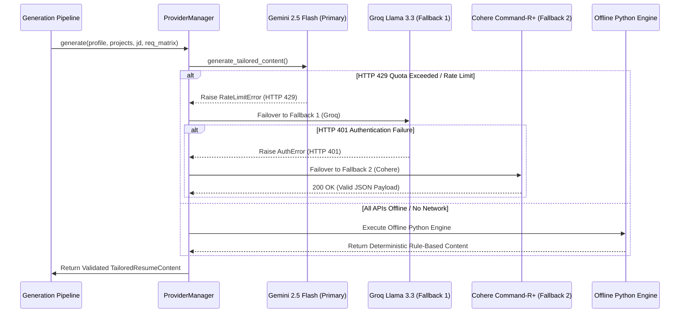

# Document 02: System Architecture & Complete Workflow
## End-to-End Technical Architecture, Multi-Profile Isolation, and Engineering Blueprint

---

## Chapter 1: System Overview

The **AI Resume Builder** is an automated, ATS-aware document tailoring system engineered to produce bespoke, verified, single-page resumes tailored to any technical Job Description.

### Core Design Principles
1. **Deterministic Document Formatting:** Typography, page boundaries, line heights, borders, and margins are managed by programmatic document engines (ReportLab and python-docx), completely removing document styling from generative AI control.
2. **Strict Factual Accuracy:** AI providers operate strictly on candidate evidence loaded from verified local databases. If a job description requests a skill not found in candidate records, the system explicitly leaves it unsupported.
3. **Multi-Provider Resilience:** The application is architected with a multi-tiered priority cascade that gracefully fails over across 5 external AI providers down to an offline deterministic Python engine.
4. **Data Isolation:** Multiple candidates are supported without cross-contamination. Profile configuration, project databases, and output packages are physically partitioned in isolated directories.

---

## Chapter 2: High-Level Architecture

```mermaid
flowchart TD
    User([User: Terminal / PowerShell]) --> CLI[resume.ps1 / CLI Orchestrator]

    subgraph Core_Pipeline [Resume Generation Pipeline]
        CLI --> PM[ProfileManager\nDirectory & Path Traversal Security]
        PM --> DLOAD[Candidate Data Loader\nmaster_profile.json & projects.json]

        CLI --> JDA[JDAnalyzer\nSkill Extraction & Canonical Taxonomy]
        DLOAD & JDA --> RMAT[RequirementMatrix\nEvidence Classification]

        RMAT --> PSEL[ProjectSelector\nWeighted Scoring & Fixed Slot Rules]

        PSEL --> SAN[Privacy Sanitizer\nRedact Phone, Email, Location]
        SAN --> AI_MGR[ProviderManager\nMulti-Provider Cascade]

        subgraph Provider_Cascade [AI Provider Cascade]
            AI_MGR --> G[Gemini 2.5 Flash]
            G -.->|Failover| GQ[Groq Llama 3.3]
            GQ -.->|Failover| C[Cohere Command-R+]
            C -.->|Failover| OR[OpenRouter API]
            OR -.->|Failover| CF[Cloudflare Workers AI]
            CF -.->|Failover| OFF[Offline Python Engine]
        end

        Provider_Cascade --> PYD[Pydantic Validation\nTailoredResumeContent Schema]

        PYD --> MAN[Content Manifest Builder\nMerge Evidence & Tailored Text]

        MAN --> COMP[Compression Engine\nVertical Budget: 777.89 pt]

        COMP --> PDF_R[ReportLab PDF Renderer\n1.5 pt Teal Border, Pale Mint Bands]
        COMP --> DOCX_R[python-docx Renderer\nWordprocessingML Tables & Borders]

        PDF_R --> ATS[ATS Validation Engine\npypdf Extraction & 100-pt Scorer]
    end

    ATS --> OUT[(output/{profile_id}/{year}/{app}/\nPDF, DOCX, PNG, ATS_Report.json)]
```

---

## Chapter 3: Multi-Profile Data Architecture

The application decouples candidate-specific business rules and technical achievements from generic pipeline logic:

```
profiles/
├── registry.json                       # Central registry with schema versions
├── demo_candidate/                     # Synthetic Demonstration Candidate
│   ├── master_profile.json             # Fictional Candidate: Aarav Sharma
│   ├── projects.json                   # 4 verified frontend projects
│   ├── profile_config.yaml             # Rules: Dynamic ranking, no exclusions
│   └── source_resumes/                 # Synthetic source documents
└── [private_profiles]/                 # Git-ignored private candidate directories
    ├── master_profile.json
    ├── projects.json
    ├── profile_config.yaml
    └── audit/migration_audit.json       # SHA-256 migration integrity verification
```

### Isolation Proof
- **File System Boundary:** Every profile is isolated to its designated folder under `profiles/{profile_id}/`.
- **Runtime Path Security:** The function `get_profile_dir()` validates profile IDs against `^[a-zA-Z0-9_\-]+$`, rejecting traversal attacks (`..`, `/`, `\`).
- **Zero Cross-Contamination Test:** Automated test suites inject distinct UUID markers into candidate profiles and verify that no marker appears in another candidate's generated documents or manifest files.

---

## Chapter 4: Complete JD-to-Resume Workflow (18 Detailed Steps)

1. **User Invocation:** User invokes `.\resume.ps1 -Profile <id> -JDPath "<path>"`.
2. **Argument Parsing:** CLI parses flags, loads environment variables via `python-dotenv`, and sets logging verbosity.
3. **Profile Validation:** `ProfileManager` validates profile existence and schema conformity.
4. **Candidate Data Ingestion:** Loads `master_profile.json`, `projects.json`, and `profile_config.yaml`.
5. **Job Description Normalization:** Cleans extraneous whitespace, formats, and punctuation from the input JD text.
6. **Technical Skill Extraction:** Identifies technical terms against a canonical taxonomy of over 200 software engineering technologies.
7. **Canonical Synonym Resolution:** Resolves variant forms (e.g., "Postgres" $\to$ "PostgreSQL", "ReactJS" $\to$ "React 18").
8. **Requirement Classification:** Categorizes skills into Must-Have and Preferred requirements.
9. **Candidate Evidence Retrieval:** Maps JD requirements against candidate skill categories and project tags.
10. **Evidence Classification:** Categorizes each requirement as Strong Match, Partial Match, Missing, or Unsupported.
11. **Project Relevance Scoring:** Computes weighted multi-factor match scores for every candidate project.
12. **Locked Rule Enforcement:** Applies candidate-specific fixed project rules (e.g., locking Bearing Fault at slot 2).
13. **Privacy Sanitization:** Statically redacts personal contact information before making AI API calls.
14. **AI Content Generation:** Dispatches prompt to the primary AI provider with strict Pydantic JSON schemas.
15. **Cascade & Fallback Execution:** Automatically fails over to secondary providers or offline engine if disruptions occur.
16. **Pydantic Validation:** Deserializes and validates the JSON response into `TailoredResumeContent`.
17. **Document Generation:** Concurrently compiles pixel-perfect PDF (ReportLab) and DOCX (python-docx) files.
18. **ATS Verification & Packaging:** Extracts plain text from the generated PDF, calculates the 100-point ATS readiness score, and saves the complete application package.

---

## Chapter 5: AI Provider Architecture & Fallback Cascade



### Provider Matrix

| Provider | Adapter Module | SDK / Client | Auth Key Name | Response Mode |
| :--- | :--- | :--- | :--- | :--- |
| **Google Gemini** | `gemini_provider.py` | `google-genai` | `GEMINI_API_KEY` | Native `response_schema` JSON |
| **Groq** | `groq_provider.py` | `groq` | `GROQ_API_KEY` | `json_object` mode |
| **Cohere** | `cohere_provider.py` | `cohere` | `COHERE_API_KEY` | `json_object` mode |
| **OpenRouter** | `openrouter_provider.py` | `httpx.Client` | `OPENROUTER_API_KEY` | JSON prompt enforcement |
| **Cloudflare** | `cloudflare_provider.py` | `httpx.Client` | `CLOUDFLARE_API_TOKEN` | JSON prompt enforcement |
| **Offline Engine**| `offline_provider.py` | Native Python | *None (Zero-Network)* | Pure Rule-Based Engine |

---

## Chapter 6: Resume Project Selection Algorithm

The project selection algorithm determines the 4 most compelling projects for any given JD using a multi-factor weighted equation:

$$\text{Relevance Score} = 0.45 \cdot S_{\text{skills}} + 0.25 \cdot S_{\text{resp}} + 0.20 \cdot S_{\text{tech}} + 0.10 \cdot S_{\text{domain}}$$

### Scoring Components
1. **$S_{\text{skills}}$ (Required Skills Coverage — 45%):**
   $$\frac{|\text{JD Must-Have Skills} \cap \text{Project Skill Tags}|}{|\text{JD Must-Have Skills}|}$$
2. **$S_{\text{resp}}$ (Responsibilities Alignment — 25%):**
   Overlap between JD responsibility verbs/nouns and project achievement bullet points.
3. **$S_{\text{tech}}$ (Tech Stack Similarity — 20%):**
   Presence of related ecosystem technologies (e.g., PostgreSQL matching an SQL requirement).
4. **$S_{\text{domain}}$ (Domain Relevance — 10%):**
   Alignment of project domain (e.g., Enterprise Backend, Machine Learning, UI/UX) with the job category.

### Fixed-Position Rule Injection
Candidates can declare mandatory project placement rules in `profile_config.yaml`. For example, if a candidate has a flagship research paper project that must appear at Position #2, the selection engine:
1. Reserves Slot #2 for the designated project.
2. Evaluates all remaining projects against the JD.
3. Fills Slots #1, #3, and #4 with the top 3 highest-scoring dynamic projects.

---

## Chapter 7: Resume Document Generation & 1-Page Constraint

### Document Geometry & Printable Boundaries
- **Sheet Dimensions:** Standard A4 ($595.27 \times 841.89\text{ pt}$).
- **Printable Margins:** Top/Bottom: $32.0\text{ pt}$, Left/Right: $36.0\text{ pt}$.
- **Vertical Budget:** $841.89 - 64.0 = 777.89\text{ pt}$.

```
┌─────────────────────────────────────────────────────────────┐
│ Outer Border: 1.5 pt Deep Teal (#174A45)                     │
│ Inset: 21.6 pt (0.3 in) from sheet edge                     │
│                                                             │
│   CANDIDATE NAME (Times-Bold 20 pt, #174A45)                │
│   Permanent Identity Headline (Times-Bold 10.5 pt)          │
│   Phone | Email (#267BF1) | Location                        │
│   LinkedIn (#267BF1) | GitHub (#267BF1) | Portfolio         │
│   ───────────────────────────────────────────────────────   │
│   PROFESSIONAL SUMMARY (Pale Mint Band #E9F0ED)             │
│   ───────────────────────────────────────────────────────   │
│   TECHNICAL SKILLS (7 Fixed Categories)                     │
│   ───────────────────────────────────────────────────────   │
│   PROJECTS (Top 4 Ranked Projects)                          │
│   ───────────────────────────────────────────────────────   │
│   PROFESSIONAL DEVELOPMENT & JOB SIMULATIONS                │
│   ───────────────────────────────────────────────────────   │
│   EDUCATION (Branch / Mechanical strictly excluded)         │
│   ───────────────────────────────────────────────────────   │
│   LEADERSHIP & ACHIEVEMENTS (DOI: #267BF1 Underlined)       │
│   ───────────────────────────────────────────────────────   │
│   CERTIFICATIONS (All Verified Credentials Joined by ·)     │
└─────────────────────────────────────────────────────────────┘
```

### Deterministic Vertical Space Compression Engine
If the uncompressed height exceeds $777.89\text{ pt}$, `compression_engine.py` applies deterministic scaling in two stages:
- **Stage 1 (Light Compression):** Reduces paragraph spacing after headings from $1.5\text{ pt}$ to $0.8\text{ pt}$, and line leading from $11\text{ pt}$ to $10.2\text{ pt}$.
- **Stage 2 (Proportional Font Scaling):** Scales body and bullet text from $9.6\text{ pt}$ to $9.0\text{ pt}$ (never below readable thresholds).

---

## Chapter 8: ATS Validation & Scoring Engine

The local ATS scoring engine operates on extracted binary text:

```
Total ATS Readiness Score: 0 – 100 Points
├── 1. Format Compatibility (30 Points Max)
│   ├── Single-Column Structure Confirmed:     +5 pts
│   ├── Strict 1-Page Layout Verified:         +8 pts
│   ├── Contact Details Fully Detectable:      +5 pts
│   ├── Standard Heading Hierarchy:            +4 pts
│   ├── Selectable Plaintext Streams:          +4 pts
│   └── Zero Prohibited Terms Detected:        +4 pts
├── 2. JD Relevance (50 Points Max)
│   ├── Must-Have Technical Skills Coverage:   +35 pts (linear scale)
│   ├── Preferred Skills Coverage:             +10 pts
│   └── Keyword Density & Natural Frequency:   +5 pts
└── 3. Content Quality (20 Points Max)
    ├── Strong Action Verbs:                   +8 pts
    ├── Quantifiable Numerical Metrics:        +6 pts
    ├── Concise Bullet Formatting:             +3 pts
    └── Evidence Verification Against DB:      +3 pts
```

---

## Chapter 9: Error Handling & Reliability Matrix

| Error Condition | Root Cause | System Detection | Automatic Recovery Action |
| :--- | :--- | :--- | :--- |
| **HTTP 429** | API quota exceeded | `RateLimitError` | Logs warning; cascades to next configured provider. |
| **HTTP 401 / 403** | Missing or expired API key | `AuthError` | Disables provider for session; fails over immediately. |
| **HTTP 500 / 503** | Upstream provider disruption | `APIError` | Retries up to 3 times with exponential backoff & jitter. |
| **Timeout (>30s)** | Slow network connection | `TimeoutException` | Aborts request; invokes next provider in priority chain. |
| **Malformed AI JSON** | Incomplete markdown block | `JSONDecodeError` | Regex extracts `{...}`; repairs missing quotes; validates defaults. |
| **Page Overflow** | Content exceeds 777.89 pt | Height audit | `compression_engine.py` compresses padding and font size. |
| **Scanned PDF Input** | 0 selectable characters | `pypdf` char count | Rejects with `ScannedPDFError`; guides candidate to OCR. |
| **Path Traversal** | Malicious profile ID | Regex audit | Rejects with `ValueError("Invalid profile ID")`. |

---

## Chapter 10: Privacy and Security Architecture

1. **Zero Secret Storage:** API keys reside exclusively in `.env` and are loaded via `python-dotenv`.
2. **Client-Side Privacy Redaction & AI Transmission Disclosure:** Candidate professional data (name, degree, institution, CGPA, verified skills, and project descriptions) is transmitted to the active AI provider to synthesize tailored summaries and bullet points. Before any network request is dispatched, `sanitize_candidate_evidence_for_privacy()` strips all personal contact information (phone numbers, personal emails, residential addresses, and personal links).
3. **Repository Cleanliness:** `.gitignore` protects all candidate resumes, output folders, and private candidate profiles (`profiles/sujal/`). Only synthetic fixtures (`profiles/demo_candidate/`) are tracked.
4. **Atomic Document Writes:** Files are written to temporary paths (`.tmp`) before atomic filesystem renaming, preventing document corruption.

---

## Chapter 11: End-to-End Walkthrough Examples

### Example 1: Java Backend Developer (Infosys Technologies)
- **Profile:** Verified Java full-stack candidate.
- **Projects Selected:**
  1. Employee Management REST API (Spring Boot, MySQL)
  2. Bearing Fault Diagnosis Using Machine Learning *(Fixed Position #2)*
  3. Online Bookstore Database Analysis (Complex SQL, Joins)
  4. SpringNotes Forge (AI PDF Automation)
- **ATS Readiness Result:** **91 / 100** (Format: 30/30, Relevance: 44/50, Quality: 17/20).
- **Page Fit:** Exactly 1 A4 page (86.6% vertical utilization).

### Example 2: Frontend Developer Demo Candidate (Razorpay)
- **Profile:** Synthetic candidate (Aarav Sharma).
- **Projects Selected (Pure Dynamic Ranking):**
  1. CloudCanvas UI Component Library (React 18, Vitest)
  2. CryptoPulse Real-Time Financial Dashboard (WebSocket, IndexedDB)
  3. FormForge Accessible Forms Engine (Zod, WAI-ARIA)
  4. PortfolioForge Web Application (Next.js, Vercel)
- **ATS Readiness Result:** **81 / 100** (Format: 30/30, Relevance: 37/50, Quality: 14/20).
- **Page Fit:** Exactly 1 A4 page (73.7% vertical utilization).

---

## Chapter 12: Limitations & Future Engineering Roadmap

### Known Engineering Limitations
1. **Heuristic ATS Model:** The 100-point score is a local heuristic estimate; commercial ATS platforms (Workday, Taleo) use proprietary undisclosed algorithms.
2. **No Bundled OCR:** Scanned PDF resumes without text streams must be converted externally.
3. **Single-Column Constraint:** Multi-column formats are intentionally not supported to guarantee ATS parsing accuracy.
4. **Project Cap:** Strictly capped at 4 projects per resume to preserve the 1-page standard.

### Future Roadmap
- [ ] Web application interface using FastAPI and React.
- [ ] Direct export to LinkedIn Profile JSON schema.
- [ ] AI-tailored cover letter generator matched to resume claims.
- [ ] Containerized deployment using Docker.
