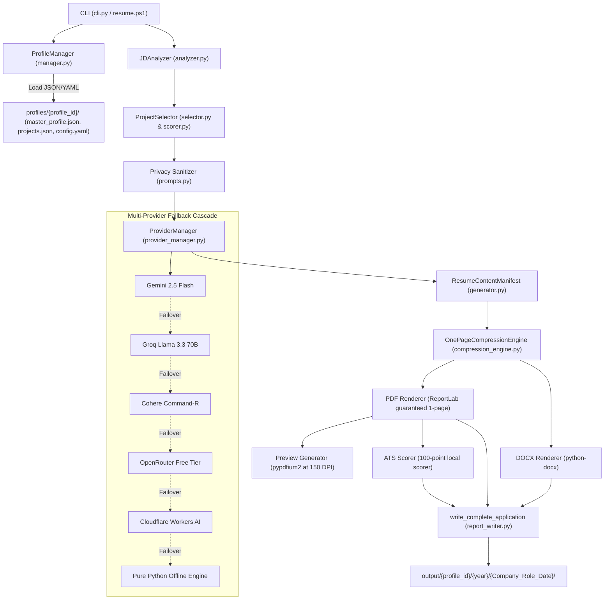

# AI Resume Builder Platform — Comprehensive Repository Audit

**Date:** November 2026  
**Auditor:** Senior Full-Stack Software Architect & QA Engineer  
**Workspace:** `D:\Sujal Kadam\Programming Notes\Web Development\Mini Projects\ai-powerd-resume-builder`  
**Git Status:** Branch `main`, tracking `origin/main` (`https://github.com/sujalkadam2906/ai-resume-builder.git`). Working tree clean (1 untracked user JD `job_descriptions/anibrain_swe.txt`).

---

## 1. Existing System Architecture Overview

The system is a production-grade, modular Python application (Python 3.10–3.13) engineered with a multi-provider AI fallback cascade, deterministic job description analysis, algorithmic project ranking with candidate-specific locked slots, a 1-page typographical compression engine, dual pixel-perfect document rendering (ReportLab PDF and python-docx DOCX), and an in-process 100-point local ATS readiness scoring engine.



---

## 2. Current Directory Structure

```text
ai-powerd-resume-builder/
│
├── .env.example                                # Master environment variables template
├── .gitattributes                              # Binary attributes for PDF/PNG/DOCX
├── .gitignore                                  # Comprehensive privacy & runtime exclusions
├── pyproject.toml                              # Root Python packaging (setuptools >=61.0)
├── README.md                                   # Root project documentation (24 sections)
├── resume.ps1                                  # Standalone CLI PowerShell wrapper
├── setup.ps1                                   # Local setup and validation automation script
│
├── src/                                        # Core Python Engine
│   └── resume_builder/
│       ├── __init__.py
│       ├── cli.py                              # CLI interface (17 flags, interactive input)
│       ├── config.py                           # AppConfig, filesystem paths, path traversal checks
│       ├── ai/                                 # AI provider abstraction & schemas
│       │   ├── fallback.py                     # Error classification & cascading retry loop
│       │   ├── gemini_client.py                # Direct Gemini API wrapper
│       │   ├── prompts.py                      # System prompts & candidate privacy redaction
│       │   ├── provider_manager.py             # Priority routing, health checks, benchmarking
│       │   ├── structured_schemas.py           # Pydantic TailoredResumeContent schema
│       │   └── providers/                      # 6 provider adapter implementations
│       │       ├── base.py                     # BaseAIProvider abstract class
│       │       ├── cloudflare_provider.py      # Cloudflare Workers AI adapter
│       │       ├── cohere_provider.py          # Cohere Command-R adapter
│       │       ├── gemini_provider.py          # Google Gemini 2.5 Flash adapter
│       │       ├── groq_provider.py            # Groq Llama 3.3 adapter
│       │       ├── offline_provider.py         # Pure Python rule-based offline adapter
│       │       └── openrouter_provider.py      # OpenRouter gateway adapter
│       ├── ats/                                # ATS Evaluation Engine
│       │   ├── rules.py                        # Action verbs & ATS scoring constants
│       │   ├── scorer.py                       # Deterministic 100-pt ATS Readiness scorer
│       │   └── validator.py                    # PDF text extraction & inspection
│       ├── content/                            # Document Content Synthesis
│       │   ├── compression_engine.py           # Exact typographical vertical point-height budgeting
│       │   ├── generator.py                    # Manifest assembler (Profile + AI + Fixed rules)
│       │   └── manifest.py                     # Pydantic ResumeContentManifest
│       ├── extraction/                         # Existing Resume Ingestion
│       │   ├── discovery.py                    # Automated file finder
│       │   ├── docx_extractor.py               # python-docx parser
│       │   ├── pdf_extractor.py                # pypdf / pdfplumber parser + scan detector
│       │   └── txt_extractor.py                # Plain text parser
│       ├── jd_analysis/                        # Job Description Analysis
│       │   ├── analyzer.py                     # Main JD analyzer & requirement evaluator
│       │   ├── keywords.py                     # Skill dictionary, synonyms, regex extractor
│       │   ├── models.py                       # JobDescription & RequirementMatrix models
│       │   └── requirement_matrix.py           # Coverage % & requirement classification
│       ├── profile/                            # Profile & Candidate Management
│       │   ├── demo_fixture.py                 # Public synthetic candidate fixture (Aarav Sharma)
│       │   ├── manager.py                      # ProfileManager (CRUD, backup, validation)
│       │   ├── migration.py                    # SHA-256 verified migration utility
│       │   ├── models.py                       # Pydantic MasterProfile, ProjectItem, ProfileConfig
│       │   └── reconciler.py                   # Conflict resolver between resume sources
│       ├── project_selection/                  # Project Scoring & Ranking
│       │   ├── scorer.py                       # Multi-factor score calculator
│       │   └── selector.py                     # Top-4 project selector with fixed position locks
│       ├── renderers/                          # Document Generation
│       │   ├── components.py                   # ReportLab flowables & layout components
│       │   ├── design_system.py                # Colors (#1B4944, #9E5A3F), margins, geometry
│       │   ├── docx_renderer.py                # python-docx matching renderer
│       │   └── pdf_renderer.py                 # Guaranteed 1-page ReportLab PDF renderer
│       ├── reports/                            # Application Packaging
│       │   ├── report_writer.py                # Writes 9-file versioned application package
│       │   └── summary_generator.py            # Markdown change summary generator
│       └── utils/                              # Utilities
│           ├── file_ops.py                     # Atomic JSON/text writing (.tmp -> replace)
│           ├── logger.py                       # Rich console & rotating file logging
│           └── text_cleaner.py                 # Typography & unicode normalizer
│
├── profiles/                                   # Candidate Data Directories
│   ├── registry.json                           # Profile catalog
│   ├── demo_candidate/                         # Public synthetic profile (Aarav Sharma)
│   └── sujal/                                  # Private candidate profile (Strictly Git-ignored)
│
├── data/                                       # Configuration & Legacy Datasets
│   ├── config.yaml                             # Global configuration (provider priority, etc.)
│   ├── master_profile.json                     # Legacy master profile (Git-ignored)
│   └── projects.json                           # Legacy projects database (Git-ignored)
│
├── job_descriptions/                           # Reference and test job descriptions
├── output/                                     # Output packages (Git-ignored)
├── docs/                                       # Project documentation & compiled PDFs
├── scripts/                                    # Utility scripts (diagrams, pdf, secret scanner)
└── tests/                                      # 9 test modules with 61 automated tests
```

---

## 3. Existing Features & Implementation Locations

| Capability | Module Path | Core Function / Class | Verified Status |
|---|---|---|---|
| **CLI Entry Point** | `src/resume_builder/cli.py` | `main()`, `run_pipeline()` | Active (17 flags supported) |
| **Path Traversal Shield** | `src/resume_builder/config.py` | `get_profile_dir()` | Validates alphanumeric regex |
| **Candidate Profile Models** | `src/resume_builder/profile/models.py` | `MasterProfile`, `ProjectItem`, `ProfileConfig` | Pydantic v2 validated |
| **Profile Manager** | `src/resume_builder/profile/manager.py` | `ProfileManager` | Atomic read/write, backups |
| **Multi-Provider AI** | `src/resume_builder/ai/provider_manager.py` | `ProviderManager` | 6 providers, priority cascade |
| **Privacy Redaction** | `src/resume_builder/ai/prompts.py` | `sanitize_candidate_evidence_for_privacy()` | Contact info stripped |
| **JD Requirement Analysis** | `src/resume_builder/jd_analysis/analyzer.py` | `JDAnalyzer.analyze()`, `evaluate_match()` | Deterministic keyword mapping |
| **Project Ranking & Fixed Slot** | `src/resume_builder/project_selection/selector.py` | `select_projects_for_jd()` | 4-factor scoring + slot #2 lock |
| **1-Page Height Budgeting** | `src/resume_builder/content/compression_engine.py` | `OnePageCompressionEngine` | Point-height precalculation |
| **ReportLab PDF Rendering** | `src/resume_builder/renderers/pdf_renderer.py` | `render_pdf_guaranteed_one_page()` | A4, 0.9pt border, 1.1pt divider |
| **DOCX Rendering** | `src/resume_builder/renderers/docx_renderer.py` | `render_docx()` | Matching python-docx styling |
| **150 DPI Preview Image** | `src/resume_builder/renderers/pdf_renderer.py` | `pypdfium2` rendering | PNG generated at page 0 |
| **100-Point ATS Scorer** | `src/resume_builder/ats/scorer.py` | `calculate_ats_readiness()` | PDF text extraction & scoring |
| **Application Package Writer** | `src/resume_builder/reports/report_writer.py` | `write_complete_application()` | 9-file versioned directory |

---

## 4. Baseline Test Results

The full test suite was executed prior to making any modifications:
* **Command:** `pytest tests/ -v`
* **Test Suite Files:** 9 modules (`test_documentation_release.py`, `test_extraction.py`, `test_gemini_fallback.py`, `test_jd_analysis.py`, `test_multi_profile_isolation.py`, `test_multi_provider.py`, `test_profile_and_reconciliation.py`, `test_project_selection.py`, `test_rendering_and_ats.py`).
* **Result:** **61 passed in 17.59s (100% pass rate)**.
* **Coverage:** Profile isolation, SHA-256 data migration, synthetic flags, privacy sanitizer, 6 provider adapter mocks, fallback cascades, ATS scoring rules, 1-page ReportLab compilation, and CLI profile commands.

---

## 5. Dependencies and Reusability Analysis

### Installed Python Dependencies (`pyproject.toml`)
- `pydantic>=2.7.0`: Reused directly for request/response validation and ORM serialization.
- `google-genai>=2.0.0`, `groq>=0.11.0`, `cohere>=5.0.0`, `httpx>=0.27.0`: Direct reuse in AI provider cascade.
- `reportlab>=4.0.0`, `python-docx>=1.1.0`, `pypdf>=4.0.0`, `pdfplumber>=0.11.0`: Direct reuse for PDF/DOCX generation and ATS text evaluation.
- `pyyaml>=6.0.0`, `python-dotenv>=1.0.0`, `rich>=13.0.0`, `pytest>=8.0.0`: Direct reuse.

### Additional Backend Dependencies Required for Web Application
- `fastapi>=0.111.0`: High-performance asynchronous API framework.
- `uvicorn[standard]>=0.30.0`: ASGI server.
- `sqlalchemy>=2.0.30`: Modern declarative ORM.
- `alembic>=1.13.0`: Schema migration tool.
- `psycopg[binary]>=3.1.18`: PostgreSQL driver.
- `python-multipart>=0.0.9`: For handling JD document uploads.
- `pytest-asyncio>=0.23.0`: For asynchronous API testing.

---

## 6. Technical Debt and Integration Risks

1. **Synchronous CPU-bound Rendering:**
   - *Risk:* ReportLab document compilation and `pypdfium2` image rendering are synchronous CPU-bound operations taking ~150–350ms.
   - *Mitigation:* In FastAPI, route endpoints must be defined with standard `def` (which offloads to AnyIO worker threadpools) or dispatched as background tasks, preventing event-loop blockage.
2. **Local Filesystem Coupling in `ProfileManager` and `ReportWriter`:**
   - *Risk:* `ProfileManager` directly loads and saves JSON files under `profiles/{profile_id}/`. `ReportWriter` writes directly to `output/`.
   - *Mitigation:* Create an adapter/service layer. For web API endpoints, database repositories handle profile persistence. A storage service abstraction (`StorageService`) handles file writing (local filesystem in dev, private object storage in production). The CLI continues to use `ProfileManager` directly.
3. **Database Selection for Development:**
   - *Requirement:* PostgreSQL must be used for both development and production.
   - *Implementation:* Docker Compose provisions a local PostgreSQL 16 container with a persistent volume, ensuring development matches production environments exactly.
4. **Cloudflare Access Token Verification:**
   - *Risk:* In deployed environments, API endpoints could be accessed directly if the origin server is public.
   - *Mitigation:* The FastAPI backend must implement a middleware that validates the `Cf-Access-Jwt-Assertion` header using Cloudflare's public JWKS certificates.

---

## 7. Recommended Migration & Integration Strategy

1. **Zero-Breaking-Change Strategy:**
   - Do not move or rename any file inside `src/resume_builder/`.
   - Install the package in editable mode (`pip install -e .`), allowing `backend/` to import `resume_builder.*` cleanly without `sys.path` hacks.
2. **Backend Structure (`backend/`):**
   - Independent FastAPI service organized into `api/`, `core/`, `database/`, `schemas/`, `services/`, and `adapters/`.
3. **Frontend Structure (`frontend/`):**
   - Independent React + TypeScript + Vite project using Tailwind CSS and shadcn/ui.
4. **Local Orchestration (`docker-compose.yml`):**
   - Multi-service compose defining `db` (PostgreSQL), `backend` (FastAPI), and `frontend` (Vite dev server) with persistent volumes.
