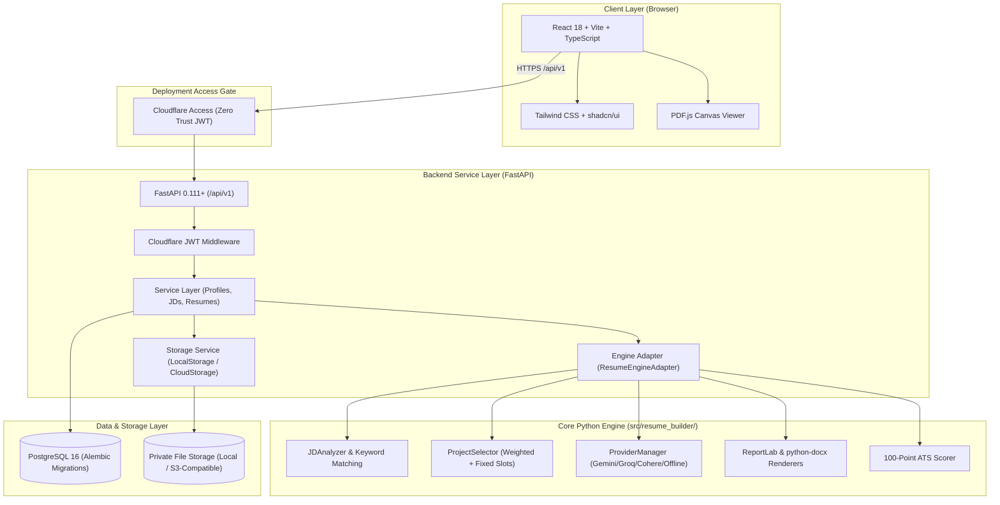
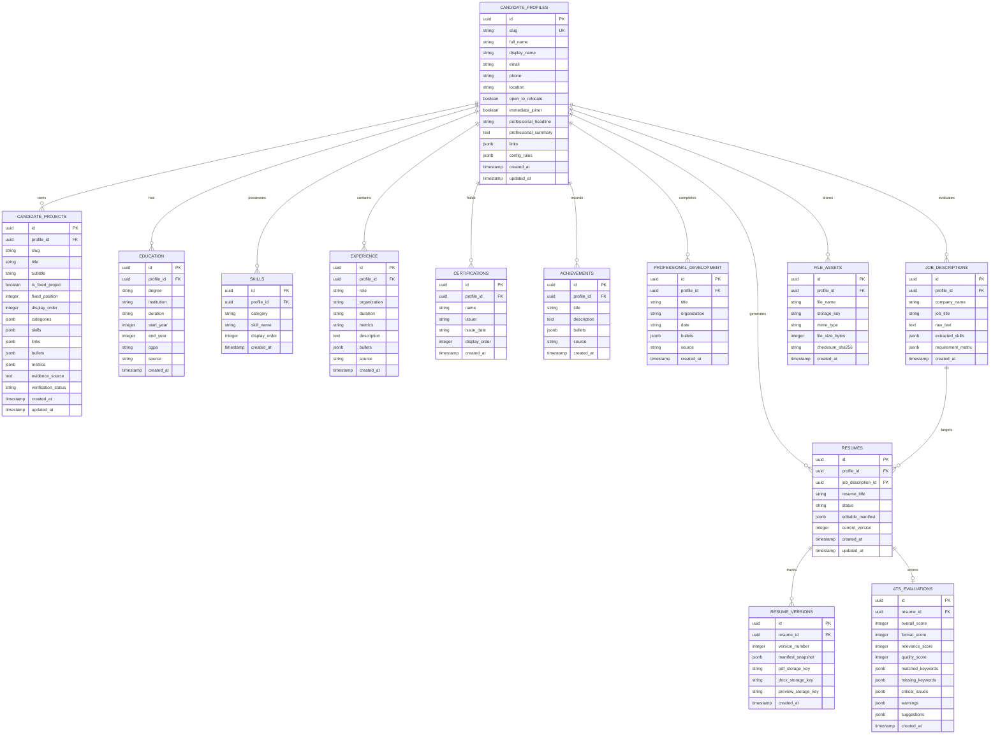
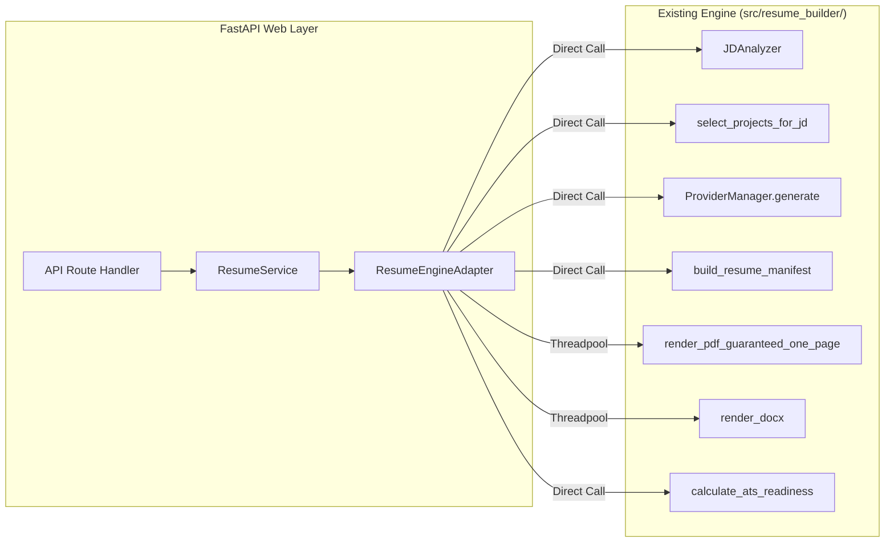

# AI Resume Builder Web Platform — Technical Blueprint & Architecture Reference

**Document Version:** 1.0.0  
**Status:** Approved Technical Blueprint  
**Primary Reference:** Single source of architectural truth for full-stack web implementation.

---

## 1. Product Vision & Architecture Principles

The **AI Resume Builder Web Platform** transforms the battle-tested terminal CLI into a modern, full-stack personal workspace.

### Core Architecture Principles
1. **Engine as Source of Truth:** The existing Python resume-generation engine (`src/resume_builder/`) remains the authoritative core. The web application is an API and UI interface to the engine, never a rewrite.
2. **Normalized Relational Data:** Candidate information is modeled in normalized relational tables with clean profile scoping.
3. **Local-First, Cloud-Ready:** Identical PostgreSQL schemas are used in local Docker development and production deployment.
4. **Zero-Trust Deployment Security:** Edge-level protection via Cloudflare Access protects both the frontend and backend without requiring redundant application login tables.
5. **Grounded AI Generation:** AI-generated content is strictly grounded in candidate database records. Skills, metrics, and bullet points are constrained to verified accomplishments.

---

## 2. System Architecture

---

## 3. Database Schema & Entity Relationship Diagram

The database uses PostgreSQL with UUID primary keys and strict profile foreign-key isolation.

---

## 4. Backend API Contracts (`/api/v1`)

### Profile Endpoints
* `GET /api/v1/profiles`: List all candidate profiles with summary statistics.
* `POST /api/v1/profiles`: Create a new candidate profile.
* `GET /api/v1/profiles/{profile_id}`: Retrieve full profile with nested relations.
* `PATCH /api/v1/profiles/{profile_id}`: Update personal info, headline, or summary.
* `DELETE /api/v1/profiles/{profile_id}`: Delete candidate profile.

### Candidate Details Endpoints (Profile Scoped)
* `GET|POST /api/v1/profiles/{profile_id}/projects`: List / Add verified projects.
* `PATCH|DELETE /api/v1/profiles/{profile_id}/projects/{project_id}`: Update / Delete project.
* `GET|POST /api/v1/profiles/{profile_id}/skills`: List / Update categorized technical skills.
* `GET|POST /api/v1/profiles/{profile_id}/education`: List / Add education records.
* `GET|POST /api/v1/profiles/{profile_id}/certifications`: List / Add certifications.
* `GET|POST /api/v1/profiles/{profile_id}/experience`: List / Add leadership & experience.

### Job Description Endpoints
* `POST /api/v1/job-descriptions/analyze`: Analyze raw JD text or uploaded file against candidate profile. Returns extracted skills, must-have vs preferred match, and match percentage.
* `GET /api/v1/job-descriptions/{id}`: Retrieve saved JD analysis.

### Resume Builder & Generation Endpoints
* `POST /api/v1/resumes/generate`: Trigger resume generation pipeline.
  - *Input:* `{ profile_id, job_description_id, requested_provider, options }`
  - *Process:* Dispatches to engine adapter in threadpool; generates `ResumeContentManifest`, compiles ReportLab PDF (1 page), renders DOCX, extracts text, computes ATS score, and stores files.
  - *Output:* `{ resume_id, version_id, status, manifest, ats_evaluation }`
* `GET /api/v1/resumes/{resume_id}`: Retrieve resume details and manifest.
* `PUT /api/v1/resumes/{resume_id}/manifest`: Update editable manifest content manually. Triggers automatic re-rendering of PDF, DOCX, and ATS score.
* `GET /api/v1/resumes/{resume_id}/pdf`: Stream binary PDF for download or preview.
* `GET /api/v1/resumes/{resume_id}/docx`: Stream binary DOCX for download.
* `GET /api/v1/resumes/{resume_id}/preview`: Stream 150 DPI preview PNG.

### System & Health Endpoints
* `GET /api/v1/health`: Basic liveness probe (`{"status": "ok"}`).
* `GET /api/v1/health/ready`: Readiness probe checking PostgreSQL and filesystem storage.
* `GET /api/v1/system/providers`: Check real-time health and availability of all 6 AI providers.

---

## 5. Safe Integration Approach for Python Resume Engine

### Integration Rules
1. **Clean Package Imports:** The backend imports the core engine directly via standard package imports (`from resume_builder.ai.provider_manager import ProviderManager`), made available via `pip install -e .`. No `sys.path` tampering or shell subprocesses.
2. **Adapter Decoupling:** `ResumeEngineAdapter` converts database entities into engine Pydantic models (`MasterProfile`, `ProjectItem`, `JobDescription`), invokes engine functions, and returns web DTOs.
3. **Threadpool Execution for Rendering:** ReportLab and `pypdfium2` rendering runs inside AnyIO threadpool workers (`run_in_threadpool`), ensuring zero latency impact on concurrent web requests.
4. **Preserved CLI Operations:** The CLI entry point `src/resume_builder/cli.py` and `resume.ps1` continue to operate independently against local JSON files.

---

## 6. UI/UX Design Direction: Premium Dark Workspace

### Visual Theme & Design Tokens
* **Background Primary:** `#0B0F17` (Deep Midnight / Slate Obsidian)
* **Surface Elevated:** `#111827` (Dark Elevated Surface)
* **Surface Border:** `#1F2937` (Subtle divider border)
* **Brand Primary:** `#3B82F6` (Electric Indigo / Sapphire Accent)
* **Brand Secondary:** `#10B981` (Emerald verification status)
* **Text High-Contrast:** `#F9FAFB` (98% lightness)
* **Text Muted:** `#9CA3AF` (Secondary labels & metrics)

### Workspace Component Hierarchy
1. **Navigation Sidebar:** Persistent dark rail with links to Dashboard, Profiles, Resume Builder, History, and Settings.
2. **Top Bar:** Active profile selector, system health indicator, and breadcrumb path.
3. **Main Content Canvas:**
   - **Dashboard:** Profile cards, recent applications list, quick-action generator launcher.
   - **Profile Manager:** Tabbed view for Personal Info, 7-Category Skills Matrix, Verified Projects with position locks, and Education.
   - **Resume Builder:** Step-by-step workflow (Select Profile -> Paste JD -> Match Matrix -> Review Projects -> Generate).
   - **Editor & Live Preview:** Split-pane interface with section-level text editor on the left and live PDF preview canvas on the right, accompanied by an interactive ATS score gauge.

---

## 7. Security, Privacy & Deployment Architecture

1. **Cloudflare Access Zero Trust Gate:**
   - Deployed web application and API sit behind Cloudflare Access at the DNS edge.
   - Incoming requests must supply a valid `Cf-Access-Jwt-Assertion` header.
   - FastAPI middleware validates the JWT against Cloudflare's public JWKS endpoint (`https://<team>.cloudflareaccess.com/cdn-cgi/access/certs`).
   - Protects both frontend and backend without requiring custom authentication database tables.
2. **Storage Abstraction:**
   - Development: Files written to private `./storage/` directory outside the frontend build.
   - Production: Files written to private S3-compatible cloud object storage (e.g. Supabase Storage / AWS S3) served via short-lived signed URLs.
3. **Environment Security:**
   - Sensitive API keys (`GEMINI_API_KEY`, `GROQ_API_KEY`, etc.) reside strictly in backend environment variables and are never transmitted to the client.

---

## 8. Milestone Roadmap & Acceptance Criteria

* **Milestone 0 (Audit & Blueprint):** Complete repository audit and architecture blueprint.
* **Milestone 1 (Foundation):** FastAPI backend, React + Vite frontend with dark shell, Docker Compose PostgreSQL setup, health checks, and baseline verification.
* **Milestone 2 (Database & Profiles):** SQLAlchemy models, Alembic migrations, full profile CRUD, and seed utility.
* **Milestone 3 (Resume Engine Integration):** JD analysis drawer, project recommendation review, and draft generation.
* **Milestone 4 (Editor & Document Management):** Split-screen editor, PDF canvas preview, ATS evaluation summary, and version history.
* **Milestone 5 (Production Deployment):** Docker production images, Cloudflare Access JWT validation, and smoke tests.
* **Milestone 6 (QA & Hardening):** Full regression test suite covering both CLI and Web API.
